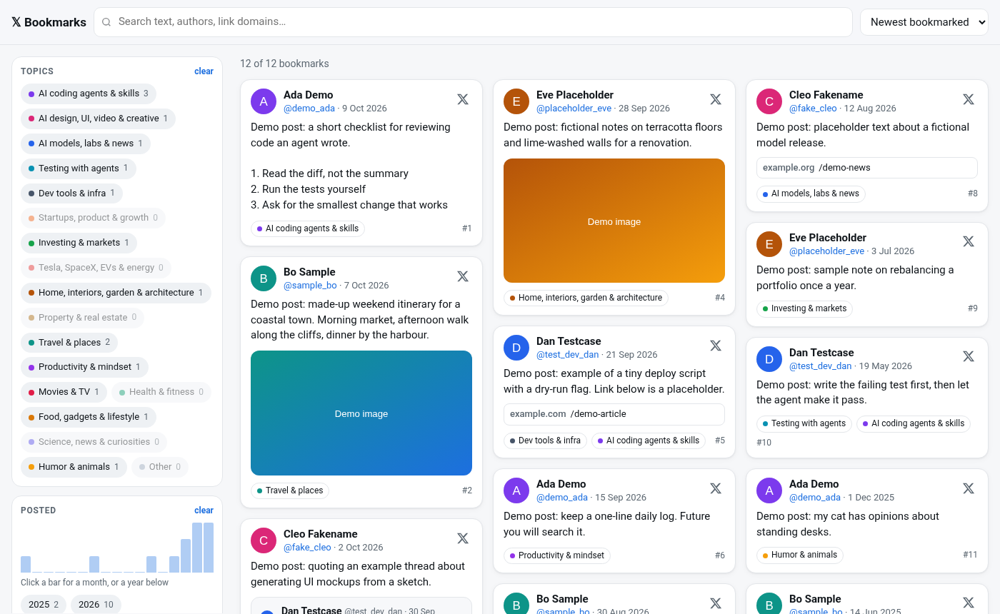
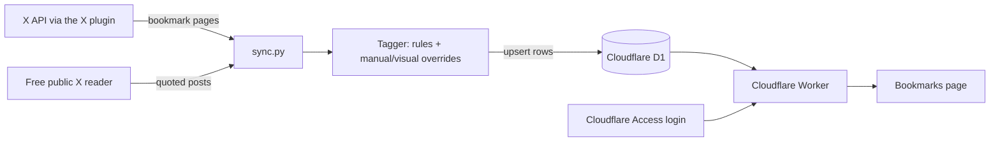

# x-bookmarks

**Find any X bookmark again.** A private, searchable browser that sorts about 2,300 saved X posts by topic, date and author.



*The bookmarks view rendered locally with a small, made-up demo dataset. No real posts or accounts are shown.*

**[Open the live site →](https://x-bookmarks.simons.workers.dev)** (private: only the owner's account can sign in)

## Every bookmark, organized

- **Browse by topic.** Each post gets one to three of 17 topic tags (plus "Other"), such as AI coding agents, travel, or home and architecture, so related posts are together.
- **Narrow it down fast.** Combine topic, month or year, author, and "has photo or video / link / quoted post" filters with full-text search across post text, quoted posts, authors and link domains.
- **See the whole post.** Quoted posts appear as nested cards, links show their domain, and every card links back to the original on X.

## How to use it

1. Open **[x-bookmarks.simons.workers.dev](https://x-bookmarks.simons.workers.dev)**, enter the allowed email address, and type in the one-time code Cloudflare emails you.
2. Pick topics, click a bar in the **Posted** histogram (a second click extends the range to a span of months) or a year, choose authors, or type in the search box.
3. Change the order with **Newest/Oldest bookmarked** or **Newest/Oldest posts**. The filters are kept in the URL, so you can bookmark or reload a view.

The page follows your system's light or dark setting and collapses the filters into a drawer on narrow screens.

## How it works



- **Export.** Bookmarks are read from the X API through Grok Bot's X plugin, 50 per page. X bills about $0.005 for every post returned. Quoted and replied-to posts are fetched through the free public X reader. `sync/lib.py` normalizes the API pages and expands `t.co` links.
- **Tagging.** `tagging/tag.py` assigns tags from `taxonomy.json` using keyword rules (`rules.py`) and learned author priors. Manual and visual-review overrides win over the rules, and posts with no clear signal are tagged "Other" and listed for review.
- **Storage and serving.** A single Worker serves the page and a read-only `/api/bookmarks` endpoint from D1. There are no write endpoints. The Worker also verifies the Cloudflare Access token itself, sends strict security headers, and caches the response per data version, so new data appears without a redeploy.
- **Daily sync.** A Grok Bot routine, run by the owner's Cloudflare bot at 07:31 Zurich time, checks the 10 newest bookmarks and fetches further pages only if all of them are new. It then fetches quoted posts, tags the new posts and upserts them into D1. The routine contract is in [`sync/README.md`](sync/README.md).

The bookmark data itself is not in this repository. Only code and docs are committed; the data files are listed in [`.gitignore`](.gitignore). If the local copy is lost, `sync/restore.py` rebuilds it from D1 (see [Recover from Cloudflare](docs/OPERATIONS.md#recover-from-cloudflare)).

## Run locally

You need Python 3.9 or later, Node.js, and Wrangler (`npx wrangler` works). There are no Python dependencies outside the standard library.

```bash
git clone https://github.com/simonhimself/x-bookmarks.git
cd x-bookmarks
python3 site/build.py                     # inlines index.html and the taxonomy into site/dist/worker.js
cd site
npx wrangler d1 execute x-bookmarks --local --file schema.sql
npx wrangler dev --local --var ALLOW_LOCAL:1
```

Open http://localhost:8787. `ALLOW_LOCAL` skips the Access check for `localhost` only. The local database starts empty, so the page shows "0 of 0 bookmarks" until you load rows with `npx wrangler d1 execute x-bookmarks --local --file <your.sql>` (columns are in [`site/schema.sql`](site/schema.sql)). The screenshot above was made this way with made-up rows.

`site/wrangler.toml` targets the production account and database. Read the [operations guide](docs/OPERATIONS.md) before deploying or running the sync.

### Validate changes

There is no automated test suite. After a change, rebuild with `python3 site/build.py`, run the local preview, and check filtering, search, sorting and the URL state by hand. For tagging changes, `python3 tagging/tag.py bookmarks.json` re-tags that data file in place, relearns the author priors and prints the post count per topic, including the share left in "Other". Re-tagged posts reach the site only after `sync/sync.py push` (see the [operations guide](docs/OPERATIONS.md)).

## Limitations

- **Single user.** Only one allowed email can sign in, and the site is read-only: tags can't be edited in the browser.
- **Needs paid X API access.** Reading bookmarks costs about $0.005 per post returned, including already-known posts on the checked page. The daily check of 10 posts costs about $0.05.
- **Updates once a day.** New bookmarks show up after the next morning sync, not instantly.
- **Tagging is heuristic.** Posts with little text, such as photos and videos, can be mis-tagged or land in "Other" until reviewed.
- **Content stays on X.** Images load from X's media servers, videos show as thumbnails that link to X, and quoted posts X no longer returns (for example deleted ones) show as unavailable.

## Project guide

| Path | Purpose |
| --- | --- |
| [`site/src/worker.template.js`](site/src/worker.template.js) | Worker: Access check, read-only API, caching, security headers |
| [`site/src/index.html`](site/src/index.html) | The bookmarks page: filters, search, cards, themes |
| [`site/schema.sql`](site/schema.sql) | D1 schema |
| [`sync/`](sync/) | Incremental sync (`sync.py`, `lib.py`), restore from D1 (`restore.py`), one-off loaders, and the [routine contract](sync/README.md) |
| [`tagging/`](tagging/) | Tagger, keyword rules and the topic taxonomy |
| [`docs/OPERATIONS.md`](docs/OPERATIONS.md) | Account configuration, deploy, data locations and recovery |
| [`EXPORT_NOTES.md`](EXPORT_NOTES.md) | Notes from the initial export: paging quirks and costs |
| [`x-guide.md`](x-guide.md) | Copy of the X plugin's usage guide |
| `normalize.py`, `parse_quoted.py`, `savepage.py`, `cluster.py`, `scripts/` | Helpers from the initial export |
